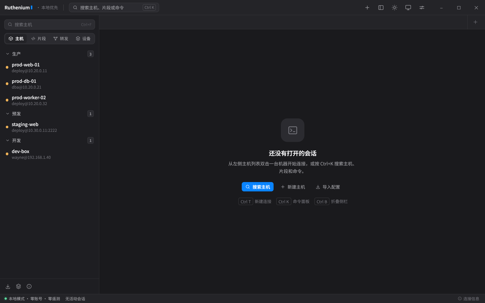
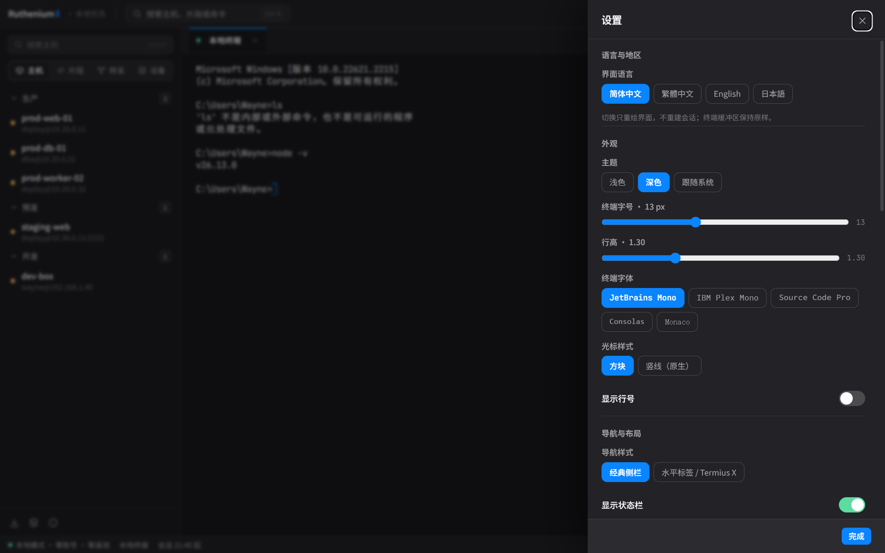
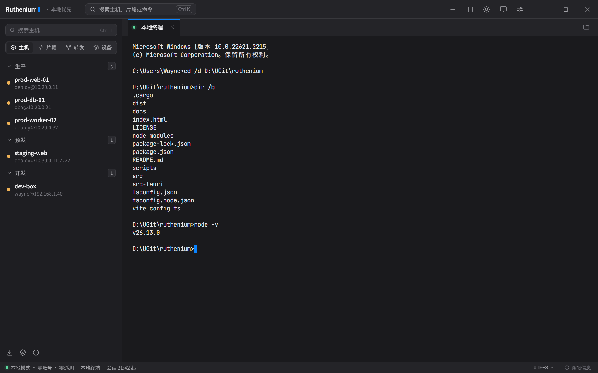

# Ruthenium

[](#)
[](#)
[](LICENSE)
[](https://tauri.app)
[](https://www.rust-lang.org)
[](https://react.dev)

本地优先的 Windows 桌面 SSH 客户端：主机、凭据与会话都留在本机，不需要账号，不连云同步，不上报遥测。

## 快速开始

前置：Windows 10 1809+ / 11 x64、Node.js LTS、Rust 工具链与 VS 生成工具（详见[安装](#安装)）。

```bash
npm install
npm run tauri:dev
```

预期：Vite 启动开发服务并弹出 Ruthenium 窗口；首次运行自动创建 `%APPDATA%\Ruthenium\hosts.toml`，侧栏为空时按 `Ctrl+N` 添加第一台主机。

## 目录

- [核心特性](#核心特性)
- [界面预览](#界面预览)
- [背景](#背景)
- [安装](#安装)
- [用法](#用法)
- [局域网对等层安全边界](#局域网对等层安全边界)
- [相关项目](#相关项目)
- [主要项目负责人](#主要项目负责人)
- [参与贡献方式](#参与贡献方式)
- [贡献人员](#贡献人员)
- [开源协议](#开源协议)

## 核心特性

- **一个文件就是全部状态**：主机、分组、片段、转发规则与偏好都写在 `hosts.toml`，可直接手改；写入采用临时文件 + rename，保留 `hosts.toml.bak`，解析失败会隔离为 `hosts.toml.corrupt-<时间戳>`，不会覆盖原文件。
- **完整 SSH 工作台**：xterm.js 终端（WebGL、查找、编码切换）、双栏 SFTP 拖拽传输、本地端口转发（`-L`）、ConPTY 本地终端，以及 Linux 主机的 CPU / 内存 / 磁盘 / 网络指标。
- **凭据不落配置**：密码存 Windows 凭据管理器（`service=Ruthenium`，`account=host:<id>`），私钥只记录路径；主机指纹复用 `~/.ssh/known_hosts` 校验，可开启 Windows Hello 启动验证。
- **局域网设备互连**：无需中继服务器，UDP 发现 + 蓝牙式配对（一键允许或 6 位码核对）后，可互传文件、远程终端、推送配置（不含密码与私钥）。
- **远程桌面**：屏幕查看默认只看，H.264（Media Foundation）优先、JPEG 回退，按 RTT 自适应帧率 / 码率 / 分辨率；支持多显示器、窗口共享、键鼠接管、富文本与图片剪贴板、系统声音（麦克风由被控端逐次确认后在会话内混音）。
- **默认收敛**：四语言界面（简中 / 繁中 / 英 / 日）、明暗主题；局域网监听默认关闭，按需开启 5 分钟可发现窗口。

## 界面预览

| 主界面：主机分组与欢迎页 | 设置：语言、主题与字体 |
|---|---|
|  |  |



> 实机截图（Windows 11，深色主题，主机为示意配置）。

## 背景

面向一个人管理 5–50 台机器的场景：连上一台机器应该是最短路径，而不是绕账号、绕云、绕同步。因此坚持四条：单一可迁移配置文件、全部状态可由该文件还原、启动即用、配置复杂度不随功能增长。

同类客户端多把配置绑定到账号或云同步；Ruthenium 把状态留在本地一个 TOML 文件里，并额外提供同一局域网内两台 Windows 机器之间的文件、终端与屏幕互连，不依赖第三方中继。

## 安装

### 安装包

下载 `Ruthenium_0.1.0-rc.1_x64-setup.exe`，按向导安装到 `C:\Program Files\Ruthenium`（需一次 UAC）。适用于 Windows 10 1809+ / 11 x64，运行时使用系统 WebView2。

### 从源码构建

| 依赖 | 要求 |
|---|---|
| Node.js | LTS（Vite 7 / React 19） |
| Rust | rustup；版本由 `src-tauri/rust-toolchain.toml` 锁定为 1.99.1 |
| VS Build Tools | MSVC 编译器 + Windows SDK |
| CMake | 编译 `audiopus_sys` 需要（VS Build Tools 通常自带） |
| WebView2 | Windows 10 需单独安装，Windows 11 自带 |

```bash
npm install
npm run tauri:dev      # 开发：Vite + 原生窗口
npm run tauri:build    # 生产打包
```

产物在 `src-tauri/target/release/bundle/`，NSIS 安装包为 `Ruthenium_0.1.0-rc.1_x64-setup.exe`。

## 用法

### 连接与管理

- `Ctrl+N` 新建主机，`Ctrl+K` 打开命令面板；侧栏单击只选中，双击或 hover 的 `▶` 才连接（同机已连会切回原标签）。
- 认证支持私钥 / 密码 / SSH Agent；密码可存进凭据管理器，私钥只按路径引用。首次连接会核对主机指纹。
- SFTP 为双栏布局，选中文件拖到对侧即传输；端口转发支持本地 `-L` 规则。
- 会话日志可选开启，远端原始字节以明文写入 `%LOCALAPPDATA%\Ruthenium\logs`；设置面板可打开目录或清空。
- 断线自动重连默认关闭，可在设置 → 行为中开启：按 1/2/4/8/16 秒退避，最多 5 次，主动断开不重连。

常用快捷键：

| 按键 | 行为 |
|---|---|
| `Ctrl+K` | 命令面板 / 快速连接 |
| `Ctrl+T` | 新建本地终端 |
| `Ctrl+Shift+W` | 关闭标签（`Ctrl+W` 留给 shell） |
| `Ctrl+Tab` | 循环切换标签 |
| `Ctrl+B` / `Ctrl+,` | 折叠侧栏 / 打开设置 |

### 配置文件示例

退出应用后编辑 `%APPDATA%\Ruthenium\hosts.toml`：

```toml
version = 1
folders = []
snippets = []
tunnels = []

[preferences]
lang = "zh-CN"
theme = "system"

[[hosts]]
id = "prod-web"
name = "Prod Web"
addr = "10.0.0.12"
user = "deploy"
port = 22
auth = "key"
keyRef = "~/.ssh/id_ed25519"
```

预期：下次启动后侧栏出现 `Prod Web`；双击连接，首次连接按提示核对 SHA256 指纹并写入 `~/.ssh/known_hosts`。

### 数据位置

| 内容 | 路径 |
|---|---|
| 主机与偏好 | `%APPDATA%\Ruthenium\hosts.toml`（上一版为 `hosts.toml.bak`） |
| 已配对设备 | `%APPDATA%\Ruthenium\peers.toml` |
| 最近控制记录 | `%APPDATA%\Ruthenium\peer-audit.jsonl`（仅元数据） |
| 会话日志 | `%LOCALAPPDATA%\Ruthenium\logs`（明文） |
| 主机密码 | Windows 凭据管理器，`service=Ruthenium` |

## 局域网对等层安全边界

- **发现**：UDP 27412 广播，自定义 `RUTHENIUM` 报文，只对格式合法的 probe 单播回包；不注册 mDNS / SSDP。
- **配对**：TCP 28410–28419。发现列表默认一键允许（TOFU，首次配对无 MITM 防护）；手填地址、严格模式或对方换钥时显示 6 位码，需两端人工核对。握手用 HKDF-SHA256 + AES-256-GCM 加密，长期 Ed25519 密钥对完整 transcript 签名。
- **连接**：SSH 27410–27419，只接受 `peers.toml` 中钉扎的设备公钥，不查 `known_hosts`、不弹指纹框。
- **授权**：文件互传 / 远程终端 / 推送配置 / 屏幕查看 / 剪贴板 / 声音六项独立，首次配对默认全不勾；撤销后实时复核（屏幕与控制 ≤5 秒，键鼠注入 ≤1 秒）。
- **远程桌面**：被控 / 被查看端每次请求都要本机确认（30 秒超时），默认只看；可选键鼠接管、文本 / HTML / RTF / 图片剪贴板与 WASAPI loopback 声音。麦克风混音需查看端开启且被控端再次本机确认，默认关，可在被控端横幅一键停止。

| 端口 | 用途 |
|---|---|
| TCP 27410–27419 | 对等 SSH（默认 27410） |
| TCP 28410–28419 | 配对（默认 28410） |
| UDP 27412 | 设备发现 |

已知边界：UAC / 安全桌面内无法捕获或注入（当前会检测并明确提示，恢复后自动继续）；独占全屏、受保护内容与 DRM 窗口无法采集（会提示原因）；H.264 硬编受厂商驱动与媒体功能包影响，可用设置 → 日志里的「复制编码诊断」排查；剪贴板支持文本 / HTML / RTF / 图片，写入前按白名单清洗 HTML 并丢弃含内嵌对象的 RTF，暂不支持文件；声音采集默认播放设备的系统声并跟随设备切换，可在会话内手动混入默认麦克风（被控端逐次确认，默认关闭，无回声消除）。

## 相关项目

- [Tauri](https://tauri.app) · [xterm.js](https://xtermjs.org) · [russh](https://github.com/Eugeny/russh) · [Opus](https://opus-codec.org)（BSD）
- 内置字体：Noto Sans CJK、JetBrains Mono、IBM Plex Mono、Source Code Pro（均为 OFL）

## 主要项目负责人

Dumese

## 参与贡献方式

改动前请确保以下检查通过：

```bash
npm run check                       # tsc + vitest + i18n 校验
npm run build                       # 前端生产构建
cd src-tauri
cargo fmt --all -- --check
cargo test
```

浏览器端 UI 回归（可选，自动完成 e2e 构建 → preview → headless 浏览器 → 清理）：

```bash
npm run test:ui
npm run test:ui -- ui-regress       # 只跑单个脚本
```

### 项目结构

| 路径 | 作用 |
|---|---|
| `src/` | React 19 + TypeScript 界面、Zustand 状态与 xterm.js 终端 |
| `src-tauri/src/ssh`、`sftp`、`tunnel` | SSH 连接、SFTP、端口转发与 `known_hosts` 校验 |
| `src-tauri/src/peer` | 设备发现、配对、远程终端、屏幕 / 输入 / 剪贴板 / 音频 |
| `src-tauri/src/config.rs` | `hosts.toml` 解析、原子写入、备份与损坏隔离 |
| `scripts/` | E2E、UI 检查、性能与对等层探针 |
| `docs/images/` | README 界面截图 |

### 贡献人员

Dumese

## 开源协议

[MIT](LICENSE) © 2026 Dumese

可自由使用、修改、分发与商用，保留版权与许可声明即可。内置字体（Noto Sans CJK / JetBrains Mono / IBM Plex Mono / Source Code Pro）为 SIL Open Font License 1.1，分发时需保留其许可声明。
